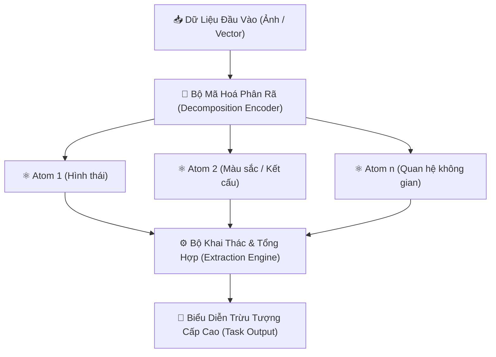

<div align="center">

# ⚛️ INFORMATIVE ATOM (HẠT THÔNG TIN) ⚛️
### 🔬 Foundational Research Framework for Atomic Feature Representations
*Khung Nghiên Cứu Nền Tảng Về Biểu Diễn Hạt Thông Tin Trong Mạng Nơ-ron Sâu*

[](https://python.org)
[](https://github.com/baolam/hat-thong-tin)
[](https://github.com/baolam/hat-thong-tin)

---

</div>

> [!IMPORTANT]
> **Hạt Thông Tin (Informative Atom)** là công trình nghiên cứu tiền đề hướng đến việc phân tách và biểu diễn thông tin thành các đơn vị "nguyên tử" tối tiểu trong không gian đặc trưng, cho phép mô hình học sâu tái cấu trúc và suy luận với mức độ trừu tượng cao hơn.

---

## 📑 Mục Lục (Table of Contents)
- [✨ Ý Tưởng & Mục Tiêu Nghiên Cứu](#-ý-tưởng--mục-tiêu-nghiên-cứu)
- [🏗️ Mô Hình Khái Niệm Hạt Thông Tin](#️-mô-hình-khái-niệm-hạt-thông-tin)
- [📂 Cấu Trúc Dự Án](#-cấu-trúc-dự-án)
- [⚙️ Công Nghệ Sử Dụng](#️-công-nghệ-sử-dụng)
- [🚀 Hướng Dẫn Chạy Thử Nghiệm](#-hướng-dẫn-chạy-thử-nghiệm)
- [📜 Giấy Phép (License)](#-giấy-phép-license)

---

## ✨ Ý Tưởng & Mục Tiêu Nghiên Cứu

| Thành Phần | Định Nghĩa Khái Niệm | Ứng Dụng |
| :--- | :--- | :--- |
| ⚛️ **Hạt Thông Tin** | Đơn vị biểu diễn nhỏ nhất chứa đựng một thuộc tính ngữ nghĩa độc lập. | Giúp mạng nơ-ron tránh ghi nhớ máy móc (overfitting) và tăng khả năng tổng quát hoá. |
| 🧩 **Cơ Chế Khai Thác** | Các toán tử biến đổi và kết hợp các hạt thông tin trong không gian tiềm ẩn (latent space). | Tái tạo và sinh biểu diễn mới phục vụ phân loại hoặc sinh dữ liệu. |
| 📊 **Hệ Thống Logging Thử Nghiệm** | Thư mục `logs/` ghi nhận toàn bộ quá trình hội tụ và biến đổi năng lượng thông tin. | Phân tích định lượng sự phân bố của các hạt trong quá trình huấn luyện. |

---

## 🏗️ Mô Hình Khái Niệm Hạt Thông Tin



---

## 📂 Cấu Trúc Dự Án

```bash
hat-thong-tin/
├── 📄 requirements.txt    # Danh mục thư viện phụ thuộc
├── 📂 src/                # Mã nguồn triển khai kiến trúc hạt thông tin
├── 📂 test/               # Kịch bản kiểm thử độc lập các toán tử hạt
├── 📂 logs/               # Nhật ký ghi nhận kết quả thực nghiệm
└── 📄 README.md           # Tài liệu hướng dẫn nghiên cứu
```

---

## ⚙️ Công Nghệ Sử Dụng

- **Core Framework**: Python 3.8+, PyTorch / NumPy
- **Analysis & Math**: SciPy, Matplotlib

---

## 🚀 Hướng Dẫn Chạy Thử Nghiệm

```bash
# 1. Clone repository
git clone https://github.com/baolam/hat-thong-tin.git
cd hat-thong-tin

# 2. Cài đặt môi trường
pip install -r requirements.txt

# 3. Chạy các kịch bản kiểm thử
python -m pytest test/
```

---

<div align="center">

## 📜 Giấy Phép (License)

Dự án được phân phối dưới giấy phép **MIT License**.

---
**Made with ❤️ by [Bảo Lâm](https://github.com/baolam)**

</div>
